# MobileClaw

An Android home screen that learns how you use your phone and helps with it. The AI runs on the phone by default; a cloud model is an optional upgrade, with your own key.

**[Get MobileClaw on Google Play](https://play.google.com/store/apps/details?id=com.la1ncher)** · Free, no ads · Android 11 or newer

| Home & HUD Clock | AI Assistant & Agents | Second Brain & Hub | Automations |
| :---: | :---: | :---: | :---: |
| 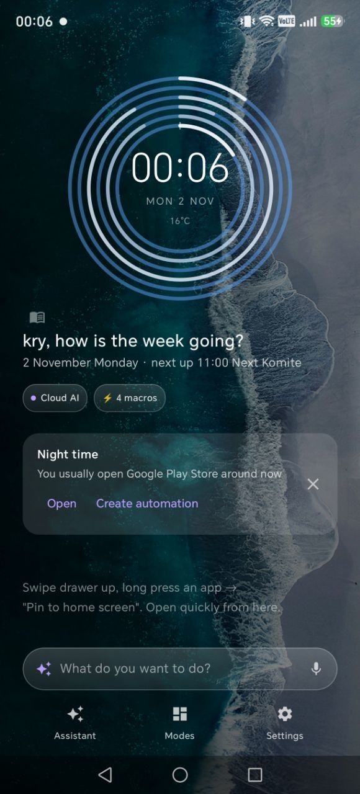 | 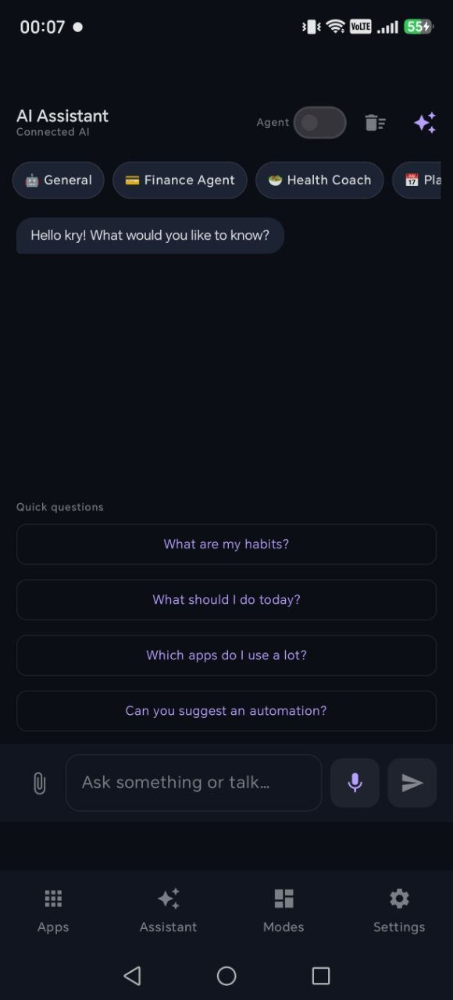 | 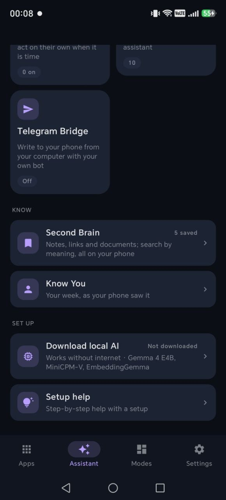 | 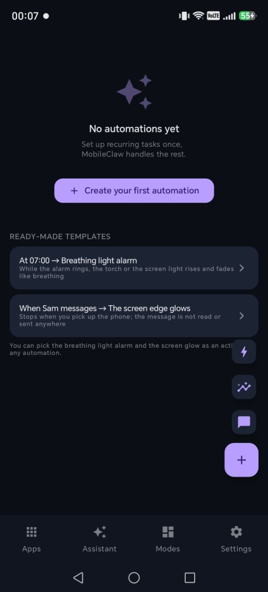 |

| Modes & Daily Brief | Smart Home & TV Remote | On-Device AI Models | Proactive & Privacy |
| :---: | :---: | :---: | :---: |
| 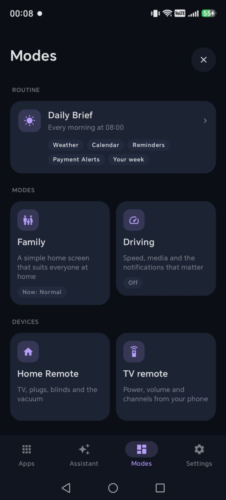 | 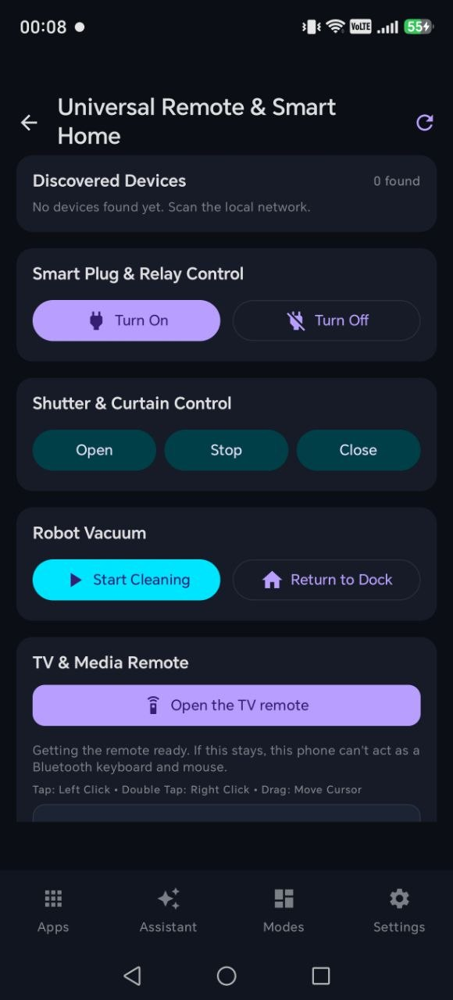 | 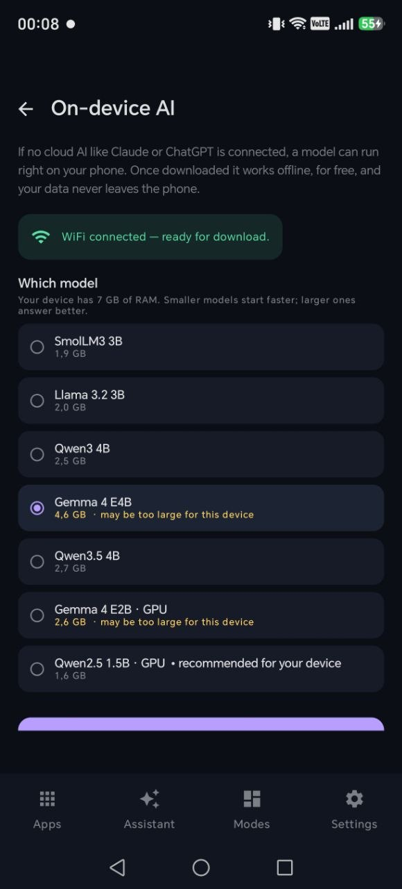 | 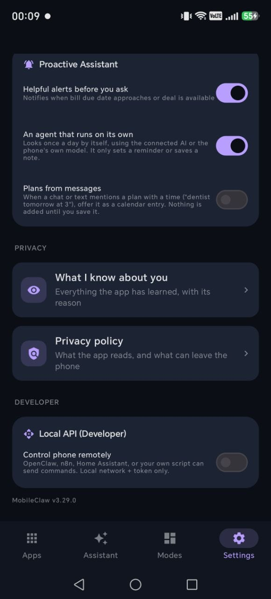 |

| E-Ink & PC Share | On-Phone vs. Cloud AI | Telegram Bridge | Drive Cockpit |
| :---: | :---: | :---: | :---: |
| 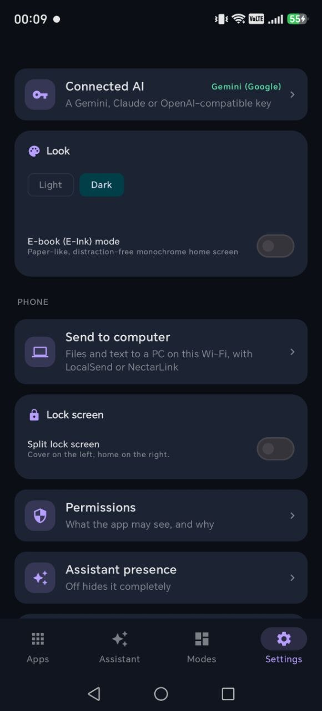 | 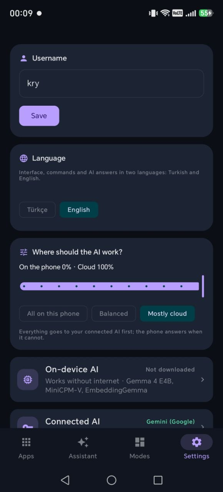 | 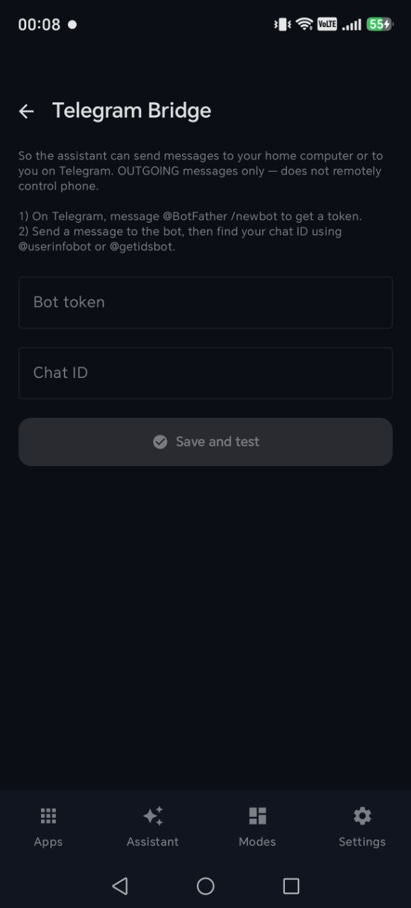 | 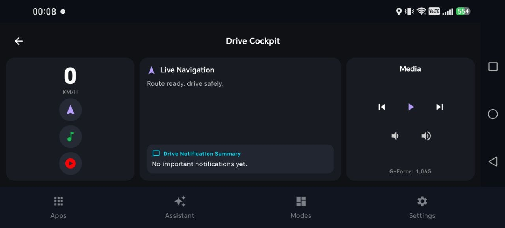 |

---

## What's in the app

### An assistant that works without the internet
- Download an open model (Gemma, Qwen) and the assistant runs on the phone, offline. Some models run on the phone's GPU.
- Or connect your own key: Claude, ChatGPT, Gemini, DeepSeek, Qwen, OpenRouter, Groq or Hugging Face. Groq and Hugging Face have free tiers.
- It sends messages, makes calls, sets alarms, starts directions, controls music, searches the web, summarizes YouTube videos, and drafts emails and to-do lists.
- Anything that leaves the phone or can't be undone, like a message, a call or a smart home command, asks you first.
- A setup coach walks you through setting things up on the phone, one step at a time.

### A home screen that learns
- Brings forward the apps you are likely to open at this hour and in this place.
- One bar for apps, contacts, notes, Android settings pages and questions, typed or spoken.
- A HUD ring clock with the temperature, and shortcut petals around it. Hold an empty spot and talk.
- A lock screen cover with your notifications, music and day.
- E-ink mode (the whole app in grayscale), a home screen widget and a chat bubble.

### Quick Settings tools
- **SOS light:** the flashlight flashes SOS.
- **Level and light:** a spirit level and a light meter.
- **Dice.**

### Memory
- **Second Brain:** notes and reminders, saved from any app with Share and found by meaning.
- **"What I know about you"** shows everything the app has concluded about you, with the evidence. Deleting a conclusion deletes the data behind it.

### Help before you ask
- A morning brief.
- Bill reminders, and bills spotted in your notifications.
- It learns which notifications you ignore and quiets them.
- When it guesses something about you, it asks instead of assuming.
- When a day looks unlike your usual days, it asks you about it once.
- Plans found in your messages are offered as calendar entries.
- Set your own habits and keep a streak.

### Automations
- Trigger, condition and action, with no code. Or describe one in a sentence: *"silence the phone when it's charging"*.
- Triggers include time, arriving at or leaving home or work, Bluetooth, headphones, battery, notifications, calendar and opening an app.
- Runs Tasker tasks and Tasker/Locale plugins.

### TV remote and home devices
- A TV remote for any brand over infrared, on phones with an IR blaster. It finds the right codes by trying them. LG, Samsung, Roku and Android TVs also work over Wi-Fi.
- Finds plugs, shutters and robot vacuums on your Wi-Fi and controls them: Kasa, Shelly and Tasmota, and vacuums running Valetudo.
- Works with Home Assistant.
- Turns the phone into a Bluetooth keyboard and touchpad for a TV or a computer.

### Send to a computer
- Sends files and text to a computer on the same Wi-Fi through LocalSend, a free app for Windows, Mac and Linux. Nothing goes through the internet.

### Simpler homes
- A big, calm home screen for an older relative, with reminders such as medicine, and memory support.
- A study helper that leads you to the answer step by step instead of giving it away.
- A friendly animated face that talks.

### In the car
- When the phone connects to the car's Bluetooth, it tells you whether a notification matters and reads it if you ask.
- **Drive Cockpit:** a driving screen with your notifications and music.

### Light
- **Wake light:** the screen or the flashlight brightens slowly, like a sunrise.
- **Message glow:** a soft light when the people you chose message you.

### Reach your phone from elsewhere
- A Telegram bridge: send your phone commands from Telegram.
- A local HTTP API, protected by a key.
- Both stay off until you turn them on, and anything irreversible still asks on the phone.

---

## Coming soon

**Already built, in the next update:**
- **MCP:** connect your own MCP servers and the assistant can use their tools. Any tool that acts asks you first.
- The assistant can hand things to other apps.
- Sign in to OpenRouter instead of pasting a key, and find all the assistant's settings on one page.
- The driving screen shows the next turn from your maps app.

**Later:**
- **Walkie-talkie:** push-to-talk between family phones, paired in person with a QR code. When the line can't connect, it leaves a voice message.
- **Home Watch:** turns a spare phone into a camera that watches a room and notices movement. Everything is worked out on that phone. It starts only from a tap on that phone, and its notification says so while it runs.
- A dashcam mode for the car.

---

## Privacy
- The AI runs on the phone by default. A cloud model is your choice, with your own key.
- No ads, no analytics, no tracking libraries.
- [Privacy policy](https://sites.google.com/view/laincher-privacy/ana-sayfa)

## Requirements
- Android 11 or newer, on a 64-bit ARM phone.
- English and Turkish. You can switch the language inside the app.

## Feedback
Found a bug, or missing something? [Open an issue](../../issues).

*The source code is not public. This repository holds the description and the issue tracker.*
